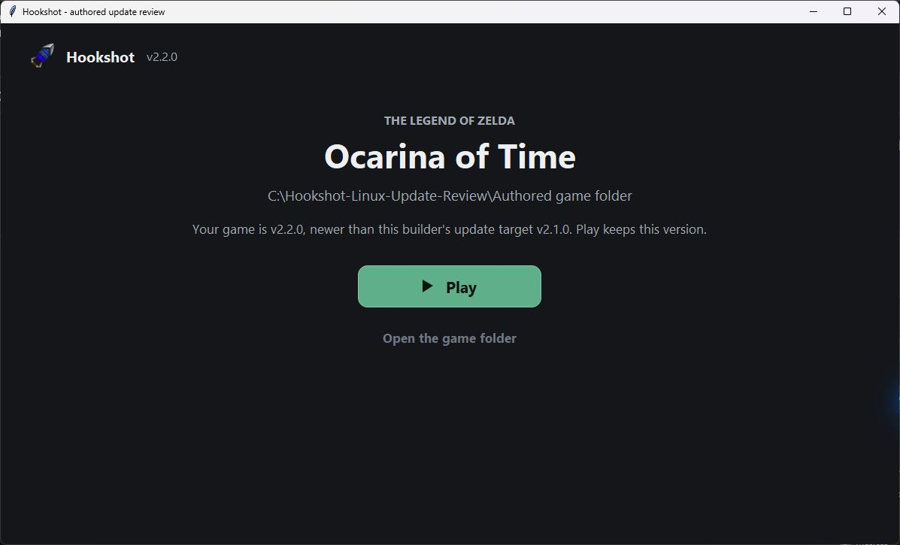

# Which Linux Builder opens a game

Starting the game folder's `hookshot` uses the executable named by `builder=` in `hookshot_version.txt` when it
still exists and is executable. This is the Builder that last built that folder. Another game's installed Builder
does not override it, whether that installed version is older or newer. The selected Builder can check its own
update track normally; starting a folder does not switch versions by itself.

If that recorded executable has been moved or removed, the wrapper falls back to the installed Builder under
`$HOOKSHOT_BUILDER_HOME/hookshot/builder`, or `$XDG_DATA_HOME/hookshot/builder` (default `~/.local/share`). With
neither available, it starts `bin/hookshot` directly. The wrapper does not run either Builder to query its version
or require an additional interpreter to compare versions.

## A newer game opened with older tools

The default button is **Play** when the known update target is older than the game's version, including when
GitHub is unavailable and only the running tools' version is known. The launcher explains the difference instead
of offering the older target as a new update.

The preview runs the production Tk launcher on Windows with authored metadata. It shows the new message;
it is not a Linux window, real AppImage update or gameplay validation.

Choosing another update track can still select an older version. Before that rebuild starts, the Builder asks
for confirmation. The same confirmation protects other rebuild entry points, including changing NVIDIA DLSS
while using older tools. Declining starts no download or build and leaves the page in place.

The downloaded release list must also name the selected target before installation or reuse of the running
tools. If GitHub's API and download list disagree during a release, the update stops with a retry message instead
of rebuilding with a different version.

When a confirmed downgrade installs another Builder, the decision carries forward once, only for the same
game version and requested Builder version. A changed game is asked again. An older Builder's handoff does not
grant consent by itself, and tools that do not match the requested version are refused before rebuilding.

Ordering follows the existing `release_key` contract: numeric release versions, release candidates before their
release, and git-describe builds after their tag. Arbitrary hashes and two different nightlies are not commit
ancestry evidence; their existing update policy is unchanged. The new launcher's explicit release selector is
separate from this default-action policy.

## Validation scope

`tests/test_linux_downgrade.py` executes the real folder wrapper against authored executables, the actual version
selector, and complete production Tk handlers with controlled UI/thread boundaries. It checks default versus
explicit choices, cancellation before a worker starts, DLSS rebuild admission, and quoted paths/fallbacks.
Existing Linux updater, track and launch checks cover the retained packaging/version contracts. These checks use
no game files and do not prove a real downloaded AppImage upgrade, game rebuild or gameplay.
