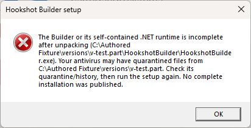

# Incomplete Windows Builder runtime

The Windows Builder is published as a directory-based, self-contained WPF application. Installing a global .NET
runtime does not replace files missing from that private runtime directory. Keep the complete installed package,
including its DLLs, dependencies and runtime configuration, together.

Setup checks the Builder executable and its required startup components before reusing an installed version,
before publishing a newly unpacked version, and before its fast installed-launch path. Missing files, empty files
and directories in place of those files fail that check. An incomplete existing installation goes through the
normal checked download/extraction path. Incomplete staging stops before the installed marker is written.

This checks the startup contract, not every optional runtime assembly or the contents/checksums of installed files.
The archive's SHA-256 verification remains separate. The required-file list in `builder/setup/setup.c` must change
with any future switch away from the directory-based WPF publish format.

The native message above was captured from the production readiness guard and error-dialog function with an
authored missing-runtime fixture. It is not a screenshot of a complete download/extraction test or of the reporter's installation.

If setup cannot complete the runtime, rerun the official setup and inspect the reported extraction/download error.
When the post-extraction check reports missing startup files, it includes the executable and staging folder paths.
Check the antivirus quarantine/history for files removed from that folder before retrying; repeatedly running setup
does not address files being quarantined again.
The game folder's direct-game fallback remains available; a failed Builder readiness check does not run the
incomplete Builder. The fixtures in `tests/test_setup_runtime*.py` use authored files and intercept process start
and publication writes; they do not execute the Builder or prove that the original missing-file cause is resolved.
