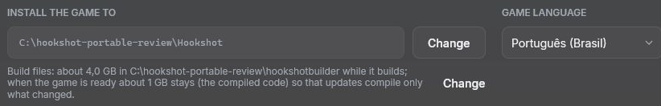

# Portable Hookshot Builder on Windows

Put the release's `HookshotBuilder.exe` setup in a writable folder on your SSD, then run:

```powershell
.\HookshotBuilder.exe --portable
```

The setup creates a marked `HookshotBuilder` data folder beside itself. Keep this folder: it contains the installed
Builder, downloaded update parts, settings, SDK downloads you opt into, and the default build files. The normal setup
continues to use `%LOCALAPPDATA%\HookshotBuilder`; portable mode does not import that installation or its settings.
To reuse existing game files, select them explicitly in the new Builder.

The default game folder is `Hookshot` beside the data folder. Keep the game and Builder on the same volume. You can
move their containing folder or change that volume's drive letter: the game records a relative association to its
Builder, and paths selected on the same volume are saved relative to the Builder home. Paths on another volume stay
absolute and may need selecting again after moving. Desktop and Start menu shortcuts start unchecked in portable
mode; selecting them explicitly creates shortcuts on that PC.



The original setup can be opened again without the flag while its marked data folder is beside it. The installed
Builder also discovers its marked home when opened directly. Updates, repair and the older ZIP update fallback use
that same home. No user/system environment variables or registry configuration are installed. Windows, .NET and
third-party tools can still create their own temporary files and operating-system caches; this is not a zero-write
or sandbox mode.

Do not remove `.hookshot-portable` from the data folder or `.hookshot_builder_home` from a game built in portable
mode. An invalid or missing association stops portable update discovery rather than silently using another Builder.
The game can still be played without the Builder, using its game launcher. An interrupted installation keeps staged
files separate from the published version. During portable updates, unchanged parts are copied instead of moved out
of the installed Builder, so enough free space for both versions is needed. A repair publishes its complete staged
directory before discarding the replaced one. If Windows blocks restoration after a failed rename, the preserved
old directory remains beside it as `<version>.rollback-*`; close programs using these folders before recovering it.

Portable mode requires the packaged setup launcher; a source checkout without that launcher cannot produce a
relocatable portable game's update association. Existing standard game folders keep their previous update behavior;
building one again with the portable Builder establishes the new association.
Rebuilding or updating a portable game with the standard Builder removes that association after successful output
finalization, so both the game launcher and update offer use the standard Builder again.

For an incomplete installed version, use **Repair** through the packaged setup launcher, keeping the portable home
in place. The older ZIP fallback reuses a matching installed version; it does not audit or repair all of its files.

For scripted child processes the setup supplies an absolute `HOOKSHOT_SETUP_BASE` and
`HOOKSHOT_BUILDER_PORTABLE=1` to that process tree only. A portable root must have the valid marker, be a dedicated
ordinary drive/UNC directory and fit the native setup's Windows path limits. Do not use the current directory, device
namespace paths or a volume root as a substitute. Portable support described here is Windows-only.

Never share a built game folder, extracted files, saves, caches or downloaded SDK packages. The contribution rules
in [CONTRIBUTING](../CONTRIBUTING.md) apply equally to portable installations.
